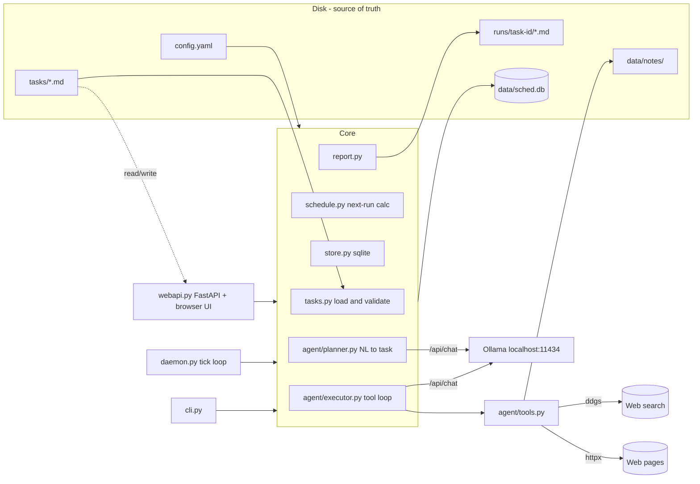

# Architecture.md

## 1. Overview

Single Python process, two entry modes: **CLI** (one-shot commands) and **daemon** (tick loop). Both share the same core modules. Task files on disk are the source of truth; SQLite holds derived schedule state and run history. LLM inference is delegated to a locally running Ollama server.



## 2. Tech stack (fixed — do not substitute)

| Concern | Choice | Why |
|---|---|---|
| Language | Python 3.11+ | zoneinfo, tomllib, wide model familiarity |
| Packaging | `pyproject.toml`, `pip install -e .` | simple |
| CLI | `typer` | declarative commands, good help text |
| LLM client | `ollama` official Python package | native tool-calling support via `ollama.chat` |
| Cron math | `croniter` | 5-field cron, tz-aware iteration |
| Web search | `ddgs` (DuckDuckGo) | no API key needed |
| HTTP fetch | `httpx` | timeouts, sane API |
| HTML → text | `beautifulsoup4` | ubiquitous |
| YAML | `pyyaml` | frontmatter parsing |
| DB | stdlib `sqlite3` | zero deps, WAL mode |
| Web UI backend | `fastapi` + `uvicorn` | `sched serve`'s JSON API + SSE run streaming (requested directly; was gated to "M6 only if reached" as a read-only API, superseded once write endpoints were explicitly requested) |
| Web UI frontend | none (vanilla HTML/CSS/JS, one static file) | no build step, no framework, consistent with the rest of the stack |
| Tests | `pytest` + `respx` (mock httpx) | see Testing.md |

Full dependency list: `typer, ollama, croniter, ddgs, httpx, beautifulsoup4, pyyaml, fastapi, uvicorn` (+ dev: `pytest, respx`). Nothing else.

## 3. Directory layout (exact)

The importable Python package is named **`schedlm`**, not `sched` — `sched` is a
Python **standard-library** module name (`import sched` resolves to it before
your own package), so a package literally named `sched` cannot be imported at
all (`ModuleNotFoundError: No module named 'sched.cli'; 'sched' is not a
package`). The CLI *binary* is still called `sched` (via `[project.scripts]`
in pyproject.toml pointing at `schedlm.cli:app`) — only the internal Python
package/import path is `schedlm`. Every `from sched.xxx import ...` in this
document and elsewhere means `from schedlm.xxx import ...`.

```
scheduler/
├── pyproject.toml
├── config.yaml                 # user config (DataModel.md §4)
├── README.md, spec.md, ...     # docs (this set)
├── src/schedlm/
│   ├── __init__.py
│   ├── cli.py                  # typer app; entry point `sched` (binary name, not import name)
│   ├── config.py               # Config dataclass; load/validate config.yaml
│   ├── daemon.py               # tick loop, catch-up, overlap guard
│   ├── tasks.py                # Task dataclass; parse/validate/write task files
│   ├── schedule.py             # next_run_at(cron, after, tz); misses/catchup logic
│   ├── store.py                # sqlite init/migrations; task-state & run CRUD
│   ├── report.py               # write run report md; prune old reports
│   ├── webapi.py                # FastAPI app for `sched serve`: list/add/edit/remove/run
│   │                            # tasks from a browser; see §5 "Web UI"
│   ├── monitor.py              # `sched monitor`: service checks, self-heal, status page (§8)
│   ├── web/
│   │   ├── __init__.py
│   │   ├── static/index.html   # single-file vanilla HTML/CSS/JS frontend, no build step
│   │   └── static/monitor.html # the agent monitor's status page
│   └── agent/
│       ├── __init__.py
│       ├── executor.py         # run_task(task, cfg) -> RunResult; the tool loop
│       ├── planner.py          # nl_to_task(sentence, cfg) -> Task draft
│       ├── prompts.py          # string constants copied from Agents.md
│       └── tools.py            # registry: schemas + implementations
├── tasks/                      # task definition files (user-editable)
├── runs/                       # <task-id>/<YYYY-MM-DDTHH-MM>.md reports
└── data/
    ├── sched.db                # sqlite (gitignored)
    ├── sched.log               # rotating log (gitignored)
    ├── monitor/                # heal.log, events.log, last-heal.json, agent output (§8)
    └── notes/                  # scratch space for read_note/write_note
```

## 4. Control flow

### Daemon tick (every `tick_seconds`)
1. Reload task files whose mtime/content-hash changed; upsert into `task_state` (new tasks get `next_run_at` computed from now; so do re-enabled tasks, which never fire a slot stored before they were disabled, and any enabled task whose `next_run_at` is NULL).
2. Select tasks where `enabled AND next_run_at <= now AND NOT currently_running`.
3. For each due task, sequentially (v1 concurrency = 1):
   - insert `runs` row (`status='running'`),
   - compute and persist the **next** `next_run_at` *before* executing (so a crash cannot double-fire),
   - call `executor.run_task` inside `try/except` with wall-clock timeout,
   - finalize the run row, write report, prune old reports.
4. Log a one-line tick summary only when something happened.

### Startup / catch-up — long-running `sched daemon` only

This phase runs **once**, only when the foreground `sched daemon` (no `--once`) launches — never for `sched daemon --once`, see below.

- For each enabled task whose `next_run_at` is in the past — if `catchup: true` and lateness ≤ `catchup_grace_minutes`, queue one run with `trigger='catchup'`; then advance `next_run_at` to the next future slot regardless.
- Any `runs` rows still marked `running` from a previous process are marked `error` with message "daemon terminated during run" (crash recovery; this part *does* also run before `--once`'s single tick).

### `sched daemon --once` is not "startup" — it is one ordinary tick

API.md documents `--once` as a lightweight substitute for the daemon, meant to be invoked repeatedly by system cron/launchd. Because of that, it must fire any due task **unconditionally**, exactly like an ordinary tick in the long-running loop — it must not route through the catch-up gate above. If it did, a task with the (default) `catchup: false` would silently never fire under a cron-driven `--once` setup, since the catch-up gate would perpetually skip-and-advance its stale slot before the tick logic ever got a chance to fire it normally. So: `--once` = crash recovery + one tick (trigger=`schedule`, unconditional); the catch-up gate is exclusively a "long-running daemon woke up after being asleep/down for a while and shouldn't mass-fire its whole backlog" feature, not a general due-task gate.

### Executor loop (detail in Agents.md §4)
messages = [system, task prompt] → `ollama.chat(model, messages, tools)` → while response has `tool_calls` and iterations < max: execute each tool, append tool results, call again → final message content becomes the report body.

## 5. Key design decisions

- **Files as source of truth.** Editing/dropping a file in `tasks/` is the primary API (US1). The DB never stores the prompt; it stores `(id, path, content_hash, next_run_at, last_run_at, running_pid)`. Deleting the file removes the task on next tick (history rows remain).
- **Compute next slot before running.** Prevents double-execution after crashes; a missed report is better than a duplicate side effect.
- **Sequential execution.** One Ollama call at a time keeps RAM predictable on consumer hardware. `max_concurrent` exists in config but v1 only honors `1`.
- **Timeout via thread.** Run the executor in a `concurrent.futures` thread with `future.result(timeout=...)`; on timeout, record `timeout` and abandon the thread (Ollama call will die with the process or finish harmlessly — its result is discarded).
- **Timezone.** All schedule math in `ZoneInfo(cfg.timezone)`; storage in UTC ISO-8601; display in local time. `croniter` is fed tz-aware datetimes so DST transitions shift correctly.
- **Search behind an interface.** `tools.py` exposes `search(query, max_results) -> list[SearchResult]`; the ddgs implementation is the only v1 provider. Config key `search.provider` reserved for future providers.
- **Custom output destinations.** `report.py` resolves `output.dir`/`output.filename` templates ({year}, {month_name}, {day}, …) at run time — needed by tasks that maintain dated files outside `runs/` (e.g. the daily-briefing task writing `~/dev/briefing/2026/July/day18.md`). Default destination and pruning stay unchanged when unset.
- **Prompt-injection stance.** Web content is wrapped in `<fetched_content>` tags when returned to the model and the system prompt says to treat it as data (spec §7 S2).
- **Executor event streaming.** `agent/executor.py::run_task` takes an optional `on_event(text: str)` callback, invoked for every tool call, tool result (truncated preview), model "thinking" output (if the model supports it), and finalization — and *always* logs the same line via its own logger regardless of whether a callback was passed, so scheduled (daemon-triggered) runs get this in `data/sched.log` too. `cli.py`'s `run`/`run all` additionally pass a callback that prints straight to stdout, for a live view of what the model is doing while it works, not just silence until a final report appears.
- **Ollama auto-start.** `daemon.py::ensure_ollama_running(cfg)` checks `cfg.ollama.host` is reachable and, if not, spawns `ollama serve` in the background (logged to `data/ollama-serve.log`) and polls briefly for it to come up. Called once by `sched run`/`run all` before executing, and once at process start by `sched daemon` (both `--once` and foreground) — this is what lets an unattended `launchctl`-managed daemon (README "Running at login") bring Ollama up itself the first time it's needed, rather than every scheduled run failing until a person starts Ollama by hand. Deliberately **not** wired into `daemon.execute_and_record`/`tick()`/`run_once()`/`run_forever()` themselves (they take an `ensure_ollama: bool = False` parameter, default off) so the test suite's `stub_execute`-based tests never touch real Ollama.
- **Web UI.** `webapi.py::create_app(cfg) -> FastAPI` backs `sched serve`, started via `uvicorn.run(...)`, bound to `127.0.0.1` by default (single-user local tool, no auth). Two addressing schemes, matching `cli.py`'s own split: file-level operations (`GET/POST/PUT/DELETE /api/tasks/file/...`) are keyed by **filename**, not task id, so a broken/invalid task file — which has no reliable parsed id — can still be opened and fixed through the UI, same as `sched list`'s `INVALID: ...` rows; id-level operations (`enable`/`disable`/`run`/`runs`) require a validly-parsed `Task`, same as `cli._resolve_task_ref`. Creating/editing a task validates via `tasks.parse_task_text` (the same validator `parse_task_file` uses, refactored to take text so content can be checked *before* it's written to disk) and returns its `TaskValidationError` message verbatim as a 400 — the browser shows the exact same field-level error `sched add --file` would print. A save immediately calls the (now-public) `daemon.sync_task_state` so `task_state`/`next_run_at` reflect the edit right away rather than waiting for the next daemon tick. `POST /api/tasks/{id}/run` reuses `executor.run_task`'s `on_event` callback exactly like `cli._run_one` does, but instead of `typer.echo`, each event is pushed onto a per-run `queue.Queue` that a background thread drains; `GET /api/runs/stream/{token}` is a `text/event-stream` (SSE) endpoint that streams those events to the browser live (tool calls, thinking, finalization), then a final `{"done": true, "status": ..., "report_path": ...}` message — giving the browser the same live "what is the model doing right now" view that `sched run` prints to the terminal.

## 6. Error handling matrix

| Failure | Behavior |
|---|---|
| Ollama not running | Daemon/web UI try to start it (`ollama serve`, found on PATH or in `/usr/local/bin`, `/opt/homebrew/bin`, `Ollama.app`); if that fails, run marked `error` ("cannot reach Ollama at <host>"); daemon keeps ticking |
| Ollama drops the connection mid-run | That chat call is retried once after 5 s (and an `ollama serve` start attempt); a second failure marks the run `error` |
| Model not pulled, can't chat (embedding/speech model), or can't call tools a task needs | Run uses the largest installed model that can (`models.py::resolve_model`; the Planner too); the substitution is logged, emitted as a run event, shown in the web UI, and the model actually used is recorded on the run. Only if nothing suitable is installed: run `error` with the Ollama error text; hint logged: `ollama pull <model>` |
| Model answers a research task without calling any tool | Told once to research first (`NO_TOOLS_NUDGE`); if it still uses no tools, the report gets a "facts are unverified" warning under its title |
| Search/network down | Tool returns error string; model instructed to finish with what it has (spec A5) |
| Invalid task file | Skipped + warning in log and `sched list` output |
| Tool raises unexpectedly | Caught in tools.py; returned to model as `{"error": "..."}` string |
| Report dir unwritable | Run `error`; report content dumped into the DB `error` column so nothing is lost |
| Daemon SIGINT/SIGTERM | Finish current tool call if quick, mark in-flight run `error` if not, exit 0 |

## 7. Observability

- `data/sched.log`: `RotatingFileHandler` (5 MB × 3), also mirrored to stderr in `sched daemon` foreground mode. Format: `2026-07-18T07:00:01 INFO [morning-brief] run started (trigger=schedule)`.
- `sched logs <id>` reads from SQLite, not the logfile.
- Every run report footer includes model, duration, iterations, and tool-call count (DataModel.md §3).

## 8. Agent monitor

`monitor.py` keeps the local stack up after a reboot or crash. `./start.sh`
installs it as two login agents next to the daemon's `com.local.sched`. All of
them run `start.sh`, so they get the same `.venv` check and repair:

| LaunchAgent | Runs | When |
|---|---|---|
| `local.agent-monitor` | `sched monitor serve`: status page + JSON at `127.0.0.1:<monitor.port>` (8790) | kept alive (`KeepAlive`) |
| `local.agent-monitor.heal` | `sched monitor heal --quiet` | at login, then every 600 s |

**Services.** The defaults are `ollama` (HTTP `<ollama.host>/api/version`;
healed with `open -g -a Ollama`), `sched` (LaunchAgent `com.local.sched` must
be running; healed by restarting it) and `monitor` (its own agent and
`/api/health`). `monitor.services` in `config.yaml` is merged with these by
name: an entry replaces the default of the same name, `enabled: false` drops it,
and new names are added (DataModel.md §4). A service passes when every check it
lists passes:
- `check.launchd`: the agent is loaded and has a pid.
- `check.http`: the URL answers with a status below 500 within 3 s.

**Heal pass.** First every service is checked. Anything down is checked again
after `heal_grace_seconds` (15), so a service still starting at login isn't
restarted. Whatever is still down is healed:
- `heal.launchd`: `launchctl kickstart -k` if the agent is loaded, otherwise
  `launchctl bootstrap` of its plist in `~/Library/LaunchAgents`.
- `heal.command`: the argv is run as given.

Each healed service is re-checked 5 s later. Each heal and its outcome go to
`data/monitor/heal.log`, and the pass is saved to `data/monitor/last-heal.json`.
Checks and heals never raise; a failure is reported as text.

**Status page.** `serve` re-checks every `check_interval_seconds` (30) in a
background thread and logs up/down changes to `data/monitor/events.log`. The
page polls `GET /api/status` (`?refresh=1` checks now). `POST
/api/services/<name>/heal` restarts one service; it requires an
`X-Sched-Monitor: 1` header, which a browser can't send cross-origin without a
CORS preflight that the server never approves, so other web pages can't
trigger restarts. The page binds to loopback only and has no auth, like
`sched serve`.

The page flags the heal agent as overdue when its last run is more than 25
minutes old. That usually means the agent was unloaded; `./start.sh` repairs it.
