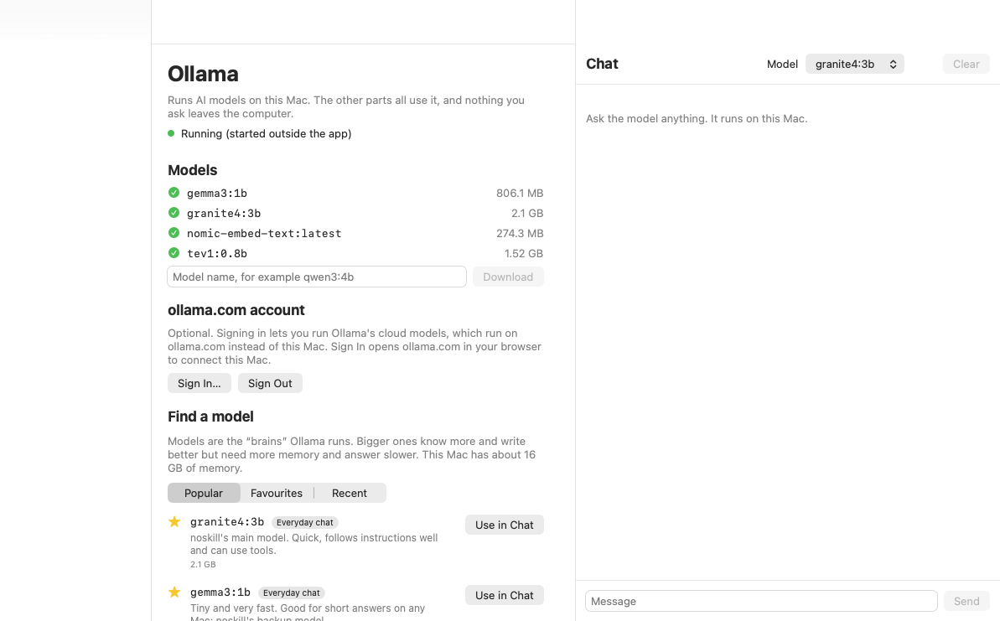

# The noskill app (macOS)

One app that starts Ollama, the noskill agent, orcastrator and sched, and shows them in one window
with a menu-bar icon. Setup explains each part and fixes what's missing; the Ollama pane installs
Ollama, finds and downloads models and chats. What it runs and why:
[docs/APP.md](../../docs/APP.md) and [ADR-0017](../../docs/adr/0017-noskill-app-runs-three-projects.md).

`--snapshot DIR` (or `NoskillApp --snapshot DIR`) re-draws this: it saves a PNG of each pane itself,
for making screenshots where screen recording isn't allowed.

## Build and run
Needs macOS 14 or later and the Command Line Tools (no Xcode). Go puts the noskill agent inside
the app; without Go the app is built without it.

    apps/macos/test.sh                  # the tests (a few seconds)
    ./build.sh                          # from the repo root: agent + app + DMG, one command
    apps/macos/build-app.sh             # tests, then apps/macos/build/noskill.app
    apps/macos/build-app.sh --install   # also copies it to /Applications (needs an admin)
    apps/macos/make-dmg.sh              # build/noskill-<version>.dmg + .sha256, checked: mounted, signature, starts
    open apps/macos/build/noskill.app

`NOSKILL_APP_SKIP_TESTS=1` skips the tests in `build-app.sh`. The version is
`CFBundleShortVersionString` in `Support/Info.plist`.

Without an admin account, install from the DMG into `~/Applications`. A DMG downloaded onto
another Mac is blocked the first time because it isn't notarized: **System Settings › Privacy &
Security › Open Anyway**.

## Code
| File | What's in it |
|---|---|
| `Config.swift` | `app.json`: project folders, ports, start on launch; first run when it's missing |
| `Catalog.swift` | The five parts: the program each runs, its port and its page |
| `Supervisor.swift` | Starting, stopping and checking the parts |
| `Setup.swift` | Setup's logic, no I/O: parts, facts, findings, fixes and their scripts |
| `Healer.swift` | Gathering facts about this Mac, running fixes, Logs' store |
| `Ollama.swift` | The Ollama pane: install, models, sign-in, chat |
| `ModelCatalog.swift` | The built-in guide to popular models; favourites and recent |
| `Views.swift` | The window (Overview, Setup, Agent, Research, Tasks, Logs) and the menu-bar menu |
| `NoskillApp.swift` | App start-up and quit; `--self-test` and `--snapshot` |
